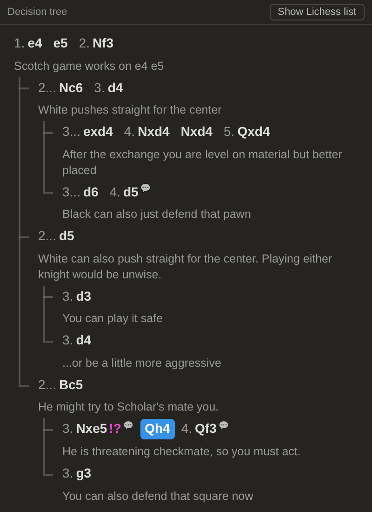

# Lichess decision tree

A userscript that shows the move list of **Lichess analysis boards and studies as a decision tree**, built for studying openings with many variations in one chapter.

## What it does

- **Every option at a branch point sits on the same level.** After `2.Nf3`, the replies `2...Nc6`, `2...d5` and `2...Bc5` are equal siblings, with no privileged "main line".
- **Forced sequences stay on one row** (e.g. `3...exd4 4.Nxd4 Nxd4 5.Qxd4`). The tree only steps deeper where there is a choice.
- **Leader lines** connect every level, like a folder tree.
- **One comment per row:** the row shows its first comment, and switches to the comment of the move you are on. Moves with a hidden comment get a 💬 marker; hover to read it.
- **Works like the normal list:** click a move to jump to it, right-click for Lichess's move menu, arrow keys work as usual.
- **"Show Lichess list" button** switches back to Lichess's own move list at any time (the choice is remembered).

Lichess's own move list stays in the page (hidden), so the explorer, engine, editing and extensions such as LiChess Tools keep working.

## Install

1. Install the **Tampermonkey** extension ([Chrome Web Store](https://chromewebstore.google.com/detail/tampermonkey/dhdgffkkebhmkfjojejmpbldmpobfkfo), also available for Firefox, Edge and Safari).
2. **Chrome only:** open `chrome://extensions` → Tampermonkey → **Details** → switch on **Allow user scripts**. (Older Chrome versions: switch on **Developer mode** at the top right of the extensions page instead.)
3. Click this link: **[Install lichess-decision-tree.user.js](https://raw.githubusercontent.com/Zahum/lichess-decision-tree/main/lichess-decision-tree.user.js)** → Tampermonkey opens → **Install**.
4. Open a study or analysis board on lichess.org (reload if it was already open).

Tampermonkey checks this repository for new versions automatically.

**Manual install:** Tampermonkey icon → *Create a new script* → replace the template with the contents of [`lichess-decision-tree.user.js`](lichess-decision-tree.user.js) → *Ctrl+S*.

## Notes

- Works in both of Lichess's move-list modes (two-column and *Inline notation*).
- Variations collapsed with Lichess's *Disclosure mode* are not shown in the tree; expand them in the Lichess list.
- The script only reads the page; it sends nothing anywhere.

## License

[MIT](LICENSE)
