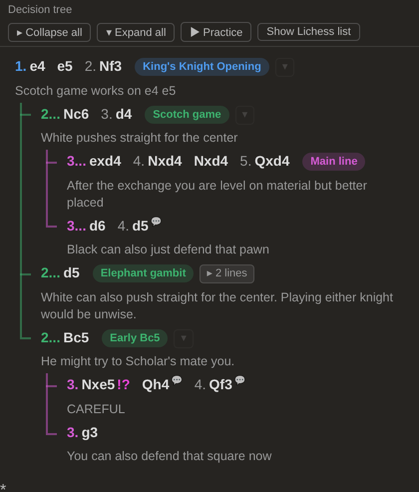
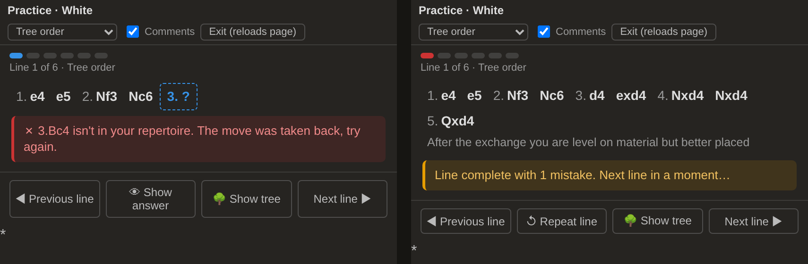

# Lichess decision tree

A userscript that shows the move list of **Lichess analysis boards and studies as a decision tree** and adds a **practice mode** that drills every line of a chapter. Built for studying openings with many variations in one chapter.

## What it does

- **Every option at a branch point sits on the same level.** After `2.Nf3`, the replies `2...Nc6`, `2...d5` and `2...Bc5` are equal siblings, with no privileged "main line".
- **Forced sequences stay on one row** (e.g. `3...exd4 4.Nxd4 Nxd4 5.Qxd4`). The tree only steps deeper where there is a choice.
- **Leader lines** connect every level, like a folder tree.
- **One comment per row:** the row shows its first comment, and switches to the comment of the move you are on. Moves with a hidden comment get a 💬 marker; hover to read it.
- **Works like the normal list:** click a move to jump to it, right-click for Lichess's move menu, arrow keys work as usual.
- **"Show Lichess list" button** switches back to Lichess's own move list at any time (the choice is remembered).

Lichess's own move list stays in the page (hidden), so the explorer, engine, editing and extensions such as LiChess Tools keep working.

## Naming and collapsing lines

- **Name a line** by starting a move's comment with the name in square brackets, e.g. `[Scotch game] White pushes straight for the center`. The name shows as a label at the end of that row, and the brackets disappear from the comment. Because the name lives in the study, it shows on every computer, in shared studies and in PGN exports.
- **Collapse a line:** hover over a row and click **▾** to hide the choices below it; **▸ 2 lines** shows what is hidden. **Collapse all / Expand all** at the top fold or unfold the whole tree. The setting is remembered per chapter, and a collapsed line opens by itself while you are on one of its moves.
- **Names on Lichess's variation buttons:** the buttons under the move list that let you pick the next variation also show the line's name (e.g. `2...Nc6 Scotch game`).
- **Colours per level:** from the second row down, each level of the tree has its own colour (line names and the move number that starts each row), so unnamed lines are easy to place too. The top row stays neutral.
- In practice mode, a line's name appears once the named move has been played (so it never gives the answer away).

## Practice mode

Click **▶ Practice** to drill the lines of the chapter.

**What gets practised depends on where you are in the tree:** on the first move (or with nothing selected) the button says **▶ Practice all**; on a move further down, e.g. `3.d4` of the Scotch, it says **▶ Practice: Scotch game (2 lines)** and drills only the lines below that move. Each line still starts from move 1; the opponent steers into the chosen lines, and a repertoire move outside them is taken back without counting as a mistake.

- You practise the side the board is turned to (flip the board to practise Black).
- The tree is hidden. You see only the **line played so far**, with `3. ?` where your move is due.
- The script plays the opponent's moves and **rotates through all his responses**, so every line (from the start to the end of a variation) comes up.
- You play your moves on the board. A wrong move is **taken back** and counted; **Show answer** reveals the move.
- **Arrows and circles** you drew in the study are **hidden** while you have to find the move. **💡 Hint** shows them for the current position (it counts as help, like Show answer). Tip: draw threats and plans on the position *after* the opponent's move, so they appear as a hint exactly when you are to move. Once a line is finished, the drawings are visible again.
- If you have more than one move in a position (e.g. `3.d3` and `3.d4`), **either is accepted** and the drill continues down that branch.
- **Progress bar:** one segment per line (green = first try, red = mistakes). Click a segment to jump to that line.
- **◀ Previous line / Next line ▶ / ↺ Repeat line**, **🌳 Show tree** at any time, and click a move of the played line to look at that position.
- **Line order:** *Tree order*, *Shuffled* or *Spaced repetition* (lines you got wrong come back sooner; remembered per chapter in your browser).
- **Comments** toggle: show each move's comment once it's played, or practise from memory only.

**Your study stays untouched:** practice switches the study's **REC** button off (moves are then kept on your screen only, never saved to the study) and back on when you exit. If you made wrong moves, *Exit* reloads the page to clear them.

While practising, Lichess's variation buttons under the move list are hidden, since they would show the possible moves. Tip: close the opening explorer and the engine while practising, they would give the answers away.

## Install

1. Install the **Tampermonkey** extension ([Chrome Web Store](https://chromewebstore.google.com/detail/tampermonkey/dhdgffkkebhmkfjojejmpbldmpobfkfo), also available for Firefox, Edge and Safari).
2. **Chrome only:** open `chrome://extensions` → Tampermonkey → **Details** → switch on **Allow user scripts**. (Older Chrome versions: switch on **Developer mode** at the top right of the extensions page instead.)
3. Click this link: **[Install lichess-decision-tree.user.js](https://raw.githubusercontent.com/Zahum/lichess-decision-tree/main/lichess-decision-tree.user.js)** → Tampermonkey opens → **Install**.
4. Open a study or analysis board on lichess.org (reload if it was already open).

Tampermonkey checks this repository for new versions automatically.

**Manual install:** Tampermonkey icon → *Create a new script* → replace the template with the contents of [`lichess-decision-tree.user.js`](lichess-decision-tree.user.js) → *Ctrl+S*.

## Notes

- Works in both of Lichess's move-list modes (two-column and *Inline notation*).
- Variations collapsed with Lichess's *Disclosure mode* are not shown in the tree; expand them in the Lichess list.
- The script only reads the page; it sends nothing anywhere.

## License

[MIT](LICENSE)
